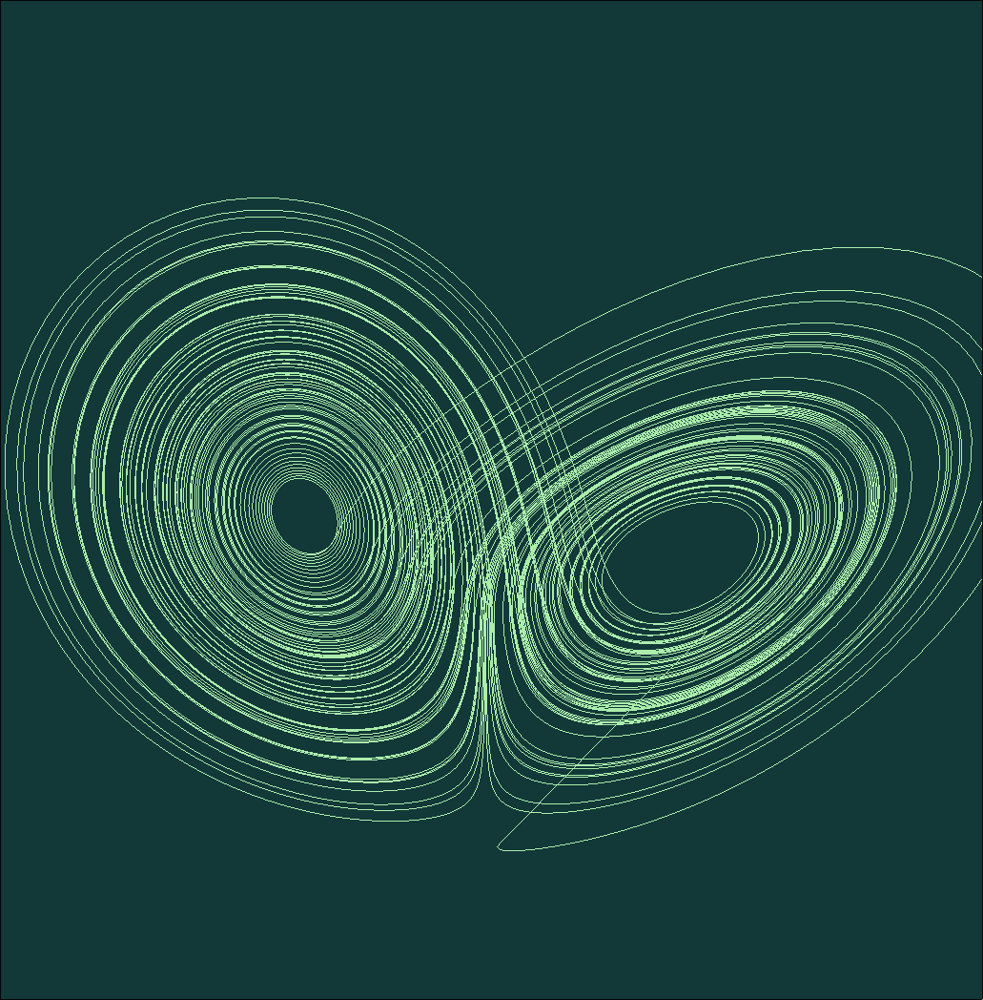

Lorenz attractor visualiser written in c++ with opengl


To compile

```
git clone https://github.com/leoburgesss/Lorenz-Attractor.git
cd Lorenz-Attractor
nix develop
cmake -S . -B build
cmake --build build
```


